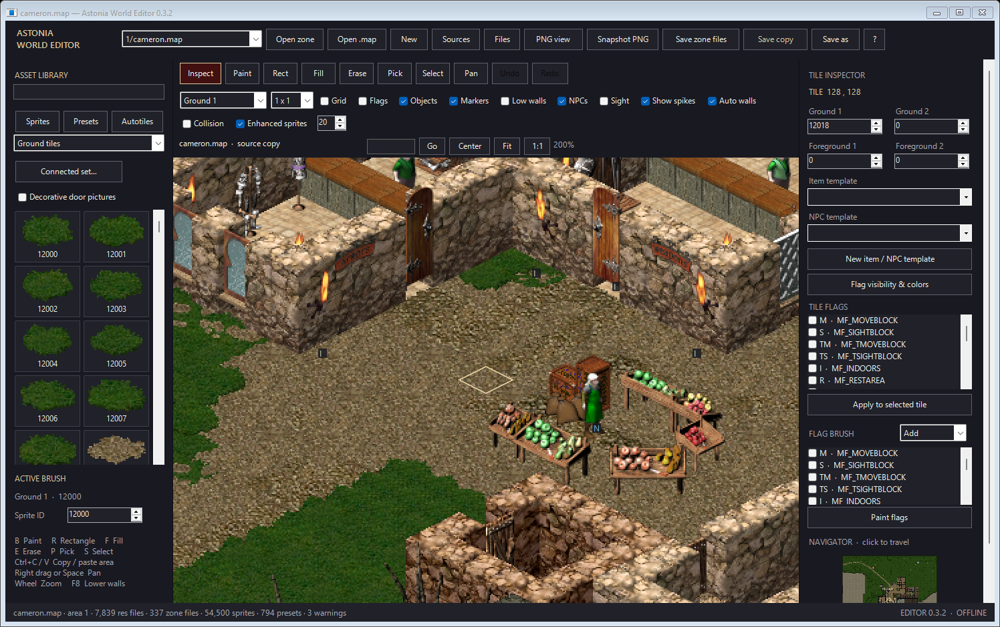
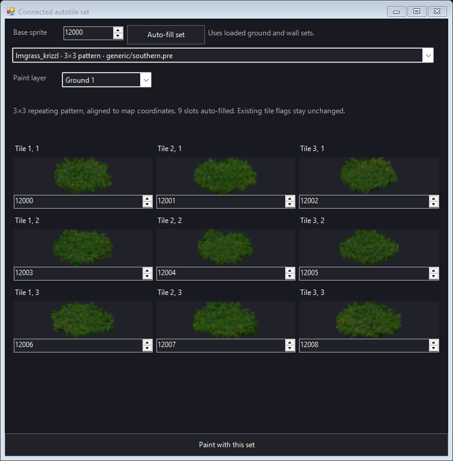
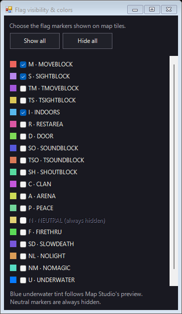
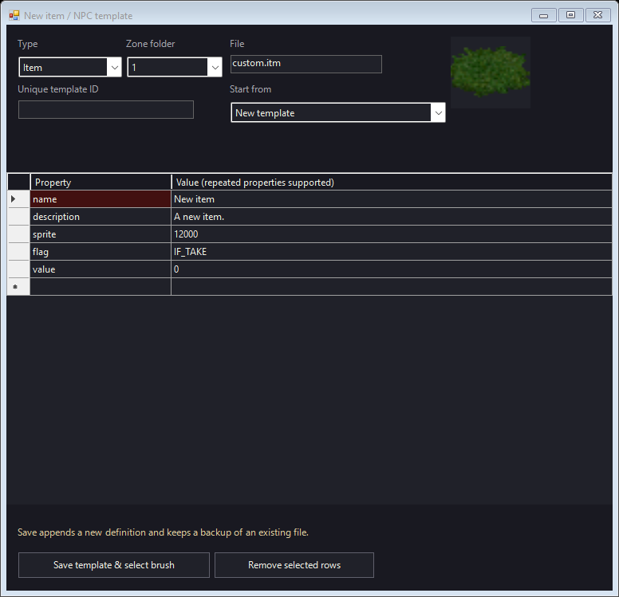
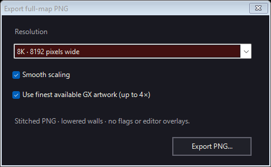
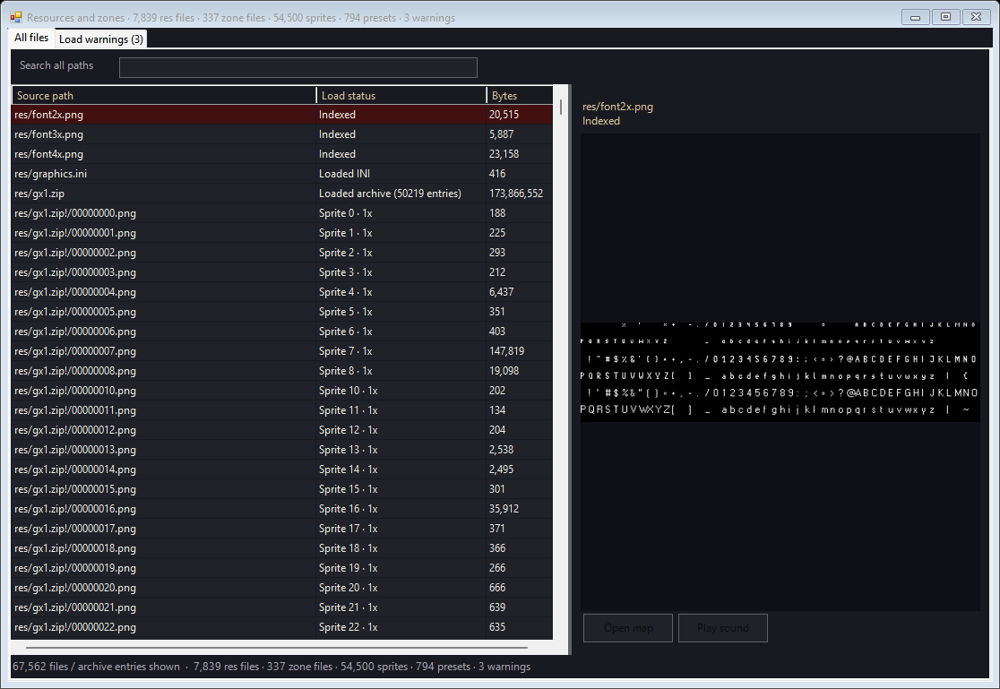

# Astonia World Editor

## User manual - version 0.3.2

Standalone Windows map editing for Astonia. This manual is written for people receiving the editor as a separate application and supplying their own compatible game resources.

Edition: October 14, 2026. Instructions and screenshots describe version 0.3.2. Features and defaults can change in later versions.

**Start here:** Extract the editor ZIP, run `AstoniaWorldEditor.exe`, choose **Sources**, select your client **res** folder and server **zones** folder, then choose a map and click **Open zone**. Loading sources references your folders; it does not copy their contents into the editor package.

The editor package supplies the application and documentation. It does not supply a complete game client, server, graphics collection, or zone collection. Screenshots use example game data; your library and map list will reflect your own files.

## Contents

1. [Install and connect your own files](#1-install-and-connect-your-own-files)
2. [Your first editing session](#2-your-first-editing-session)
3. [Find your way around the interface](#3-find-your-way-around-the-interface)
4. [Understand layers and brushes](#4-understand-layers-and-brushes)
5. [Painting and selection tools](#5-painting-and-selection-tools)
6. [Use the asset library and original presets](#6-use-the-asset-library-and-original-presets)
7. [Connected sets and automatic variations](#7-connected-sets-and-automatic-variations)
8. [Whole-tile stamps, copying and inspector edits](#8-whole-tile-stamps-copying-and-inspector-edits)
9. [Flags, colors and identifiers](#9-flags-colors-and-identifiers)
10. [Items, NPCs and doors](#10-items-npcs-and-doors)
11. [Create templates, holes and ladders](#11-create-templates-holes-and-ladders)
12. [View modes, low walls and sight](#12-view-modes-low-walls-and-sight)
13. [Save working copies, source zones and backups](#13-save-working-copies-source-zones-and-backups)
14. [Export high-quality PNG maps](#14-export-high-quality-png-maps)
15. [Files, troubleshooting and recovery](#15-files-troubleshooting-and-recovery)
16. [Share the editor and manage custom projects](#16-share-the-editor-and-manage-custom-projects)
17. [Keyboard and task reference](#17-keyboard-and-task-reference)

<!-- pdf:contents -->

<!-- pdf:pagebreak -->

# 1. Install and connect your own files

## 1.1 What you need

- A Windows x64 computer with .NET Framework 4.8.
- An extracted editor distribution in a folder you can write to.
- A compatible client resource folder containing numbered PNG artwork, loose or inside GX ZIP archives.
- A server zones folder containing the area folders, map files, item/NPC definitions and presets you want to use.

The editor runs offline. A running client, server, browser, Python installation or account sign-in is not required. Game drivers and live game behavior are not executed by the editor.

Keep the editor in its own folder, such as `D:\Tools\AstoniaWorldEditor`. Run the extracted executable rather than opening it inside the ZIP. A writable editor folder lets it retain source paths, preferences and default working copies.

## 1.2 Identify the correct folders

Your client and server may be in different locations. These are examples, not required paths:

```text
D:\MyAstoniaClient\
  res\                         <- select this graphics folder
    gx1.zip
    gx2.zip                    <- if available
    gx4.zip                    <- if available
    gx1_patch.zip              <- if supplied by your client
    gx1_mod.zip                <- if supplied by your client
    config\
      sprite_metadata.json
      animated_variants.json
      character_variants.json

E:\MyAstoniaServer\
  zones\                       <- select this zones folder
    generic\
      ... .itm / .chr / .pre
    1\
      ... .map / .itm / .chr / .pre
    2\
      ...
    presets\                   <- if your project uses this folder
      ... .pre
```

**Graphics folder:** Choose the folder containing your resource archives or numbered PNG subfolders. Select `res`, not the client executable and not a single `gx1.zip` file. Keep ZIP archives in place; extraction is not required. Keep the resource subfolders and configuration files that came with that client.

**Zones folder:** Choose the parent folder containing the numbered areas and shared `generic` folder. Select `zones`, not just `zones\1`, and not the server executable. This lets the editor discover maps and definitions across areas.

Matching client and server data matters. A map contains sprite numbers and template IDs; it does not contain the artwork or the complete item/NPC definitions needed to display those references.

## 1.3 First launch: load your res and zones folders

1. Run `AstoniaWorldEditor.exe`.
2. Click **Sources** in the top row.
3. In **Graphics folder**, type the path to your `res` folder, or use its browse button.
4. In **Zones folder**, type the path to your `zones` folder, or use its browse button.
5. Click **Load sources**. Both folders must exist, and the graphics folder must contain recognized sprite PNGs.
6. Close the source dialog if it is still open.
7. Choose a relative map path in the top map dropdown, then click **Open zone**.
8. Click **Fit** to see the map's extent, or use **Go** with a known coordinate.

Source loading scans the folder trees, archive entries and supported definitions. It catalogs other file types too, but listing a file does not mean that the editor can render or execute it. Image decoding happens as artwork is needed.

If the editor discovers a nearby compatible project automatically, it may open Cameron on startup. That is a convenience; it does not replace **Sources** when you want to use another project.

## 1.4 What importing means

Loading sources keeps references to files in the locations you selected. It does not upload them, copy them into the distribution, or convert their format. Keep those folders available while editing. Moving them or disconnecting their drive requires choosing their new locations through **Sources**.

The editor stores the selected absolute paths in `sources.ini` beside the executable when that folder is writable. Those paths are local to your computer. Another recipient must select their own folders.

To change projects or refresh files edited outside the application, open **Sources** again and click **Load sources** using the desired paths. Then open the intended map from that source set. Reopen a map if its disk contents changed; reloading the catalog alone does not replace the map already in memory.

## 1.5 Check that the import succeeded

Open **Files** and inspect **All files**. You should see `res/` and `zones/` entries, ZIP contents where applicable, and load statuses. The **Load warnings** tab explains individual failures and invalid definitions.

Confirm that the map dropdown contains your maps, that the sprite library has thumbnails, and that the item/NPC entries show the expected area and source file. Counts vary by project. This manual does not require a particular number of maps, sprites or templates.

<!-- pdf:pagebreak -->

# 2. Your first editing session

This walkthrough creates a working copy before you make changes to a source zone.

1. Load your own sources as described in chapter 1.
2. Choose a map and click **Open zone**. The filename strip identifies it as a **source copy**.
3. Press **Ctrl+S**. Choose a working filename in the save dialog. The default location is a `Maps` folder beside the executable; you can choose another writable folder.
4. Click **Fit**, then zoom in with the mouse wheel. Right-drag to pan.
5. Choose **Ground tiles** in the library, then click a sprite thumbnail.
6. Check that the active layer is **Ground 1** and the brush size is **1 x 1**.
7. Press **B** for Paint. Click or drag over a few tiles.
8. Press **Ctrl+Z** to undo the stroke. Press **Ctrl+Y** to redo it.
9. Press **I** for Inspect and click a tile. Check its sprite IDs and flags in the right panel.
10. Press **Ctrl+S** again to save the working copy.

An asterisk beside the filename means the map has unsaved changes. The lower status strip describes actions, selections and errors. The active brush label tells you whether you are using a single sprite, a template, a preset or a connected set.

**A useful habit:** Before painting, check the active tool, layer, brush label and brush size. A correctly selected sprite can still paint the wrong field if a different layer is active.

## Make a new map

Click **New** or press **Ctrl+N** to create a blank 256 x 256 map. A new map inherits the currently active area context. Open a map from the intended area first if you need its item and NPC definitions, then click **New**.

Save the new map with **Ctrl+S**. Creating a new document does not automatically create a server area, register it with the server, or write it into the source zones directory.

## Leave or switch documents

Opening another map, creating a new one, or closing the editor prompts you to save when the current map is dirty. **Yes** runs the normal map save, **No** discards unsaved map edits, and **Cancel** keeps the current document open.

Only one map document is open at a time. Template files saved through the template form are separate disk changes; discarding a map does not remove a template you already created.

<!-- pdf:pagebreak -->

# 3. Find your way around the interface



*Figure 1. The editor window. Toolbar rows wrap when the window is narrower. Screenshots show example resources.*

| Area | What you use it for |
| --- | --- |
| Top file row | Choose/open a zone, open a .map, create a map, select Sources, browse Files, export PNGs and save. |
| Left asset library | Search sprites and templates; switch Sprites, Presets and Autotiles; configure a connected set. |
| Active brush panel | Check the selected brush and single-sprite ID. |
| Center tool row | Inspect, Paint, Rect, Fill, Erase, Pick, Select, Pan, Undo and Redo. |
| Layer and view rows | Choose the field being edited, brush size, grid, overlays and display options. |
| Filename/navigation row | Read source/working-copy status, go to coordinates, Center, Fit and use 1:1 scale. |
| Right Tile Inspector | Inspect/edit one tile or apply changed properties to a selected rectangle. |
| Right Flag Brush | Choose flag operations and flags to paint. |
| Navigator | Click or drag the minimap to travel around the map. Scroll the right panel if needed. |
| Bottom status strip | Read action results, warnings, source counts and the editor version. |

## Navigation and scale

- **Right drag** or **middle drag:** pan without changing your active editing tool.
- **Hold Space and drag:** temporary pan. Release Space to return to normal interaction.
- **Pan / H:** drag with the left mouse button to pan.
- **Mouse wheel:** zoom around the pointer, keeping the pointed location in place.
- **Go:** enter `x,y`, for example `139,200`, then press Enter or click **Go**. This centers and selects that tile.
- **Center:** center on tile `128,128`.
- **Fit:** fit the occupied map extent into the canvas.
- **1:1:** set the viewport to native world scale, with 40 x 20 pixel tile diamonds.

Map coordinates range from 0 to 255 on each axis. The isometric display rotates the apparent directions: increasing X moves southeast on screen; increasing Y moves southwest. The minimap is a top-down navigation aid, not a second isometric editor.

<!-- pdf:pagebreak -->

# 4. Understand layers and brushes

A tile can contain multiple independent fields. Changing one sprite layer normally leaves the other sprite layers, item, NPC and flags in place.

| Layer | Contents | Clearing it |
| --- | --- | --- |
| Ground 1 | Main floor/terrain sprite. | Sprite ID 0 or Erase. |
| Ground 2 | Additional ground artwork, overlays and details. | Sprite ID 0 or Erase. |
| Foreground 1 | Walls, buildings and foreground scenery. | Sprite ID 0 or Erase. |
| Foreground 2 | Additional foreground artwork. | Sprite ID 0 or Erase. |
| Item | One item template reference. | Empty template field or Erase. |
| NPC | One NPC template reference. | Empty template field or Erase. |
| Flags | A set of canonical map flags. | Flag operations, or Erase for the whole flag set. |
| Whole tile | All sprite fields, item, NPC, flags and retained extra directives together. | Erase clears the entire tile. |

Map sprite fields accept IDs from 0 through 65535. ID 0 means no sprite in that field. Character image frames can have larger numbers in the resource browser; place characters through **NPC templates**, not by entering those frame IDs into a map sprite field.

## Brush types

**Single sprite:** Select a thumbnail or enter its number in **Sprite ID**. Choose the target sprite layer and Paint, Rect or Fill.

**Template:** Select an item or NPC definition. Painting stores the template ID in the appropriate field; its artwork comes from the loaded definition.

**Preset:** Select a PRESET, CHANCE, GROUND or LINEWALL definition. Its rules determine the artwork and may change flags and multiple fields.

**Connected set:** Configure a pattern, sequence or neighbor-connected brush through **Connected set...**. See chapter 7.

**Whole tile:** Shift-click an existing tile to copy all its fields into a stamp brush. See chapter 8.

## Brush size and footprint

Sizes are 1 x 1, 2 x 2, 3 x 3, 4 x 4, 5 x 5, 8 x 8 and 9 x 9. A Paint or Erase stamp begins at the hovered tile and extends toward increasing X and Y. The hovered tile is the footprint's coordinate corner; the brush is not centered on it.

Brushes clip at the 256 x 256 map boundary. The ghost preview helps you see the footprint before placing it. **Rect** uses the rectangle you drag between its endpoints, rather than expanding that rectangle by the brush size.

Changing the category, active layer or numeric Sprite ID clears an active preset/connected brush. Set the target layer inside the connected-set dialog before applying it, and check the active brush label afterward.

<!-- pdf:pagebreak -->

# 5. Painting and selection tools

| Tool | Key | Behavior |
| --- | --- | --- |
| Inspect | I | Click a tile to select it and read its fields without painting. |
| Paint | B | Click or drag to apply the active brush. A drag is one undoable stroke. |
| Rect | R | Drag between opposite corners; release to fill the inclusive tile rectangle. |
| Fill | F | Replace a contiguous region whose current active-layer value matches the clicked tile. |
| Erase | E | Click or drag to clear the active layer, using the current brush size. |
| Pick | P | Click to read the active layer into the brush. It does not automatically change to Paint. |
| Select | S | Drag an inclusive rectangular tile selection for copy, clear or inspector edits. |
| Pan | H | Drag the view without changing map data. |

## Flood fill boundaries

Fill compares the active layer. With Ground 1 active, a different Ground 1 sprite is a boundary even if another sprite layer looks continuous. With Item or NPC active, the template reference is the value being compared. With Flags active, the complete current flag set is compared.

An empty connected region can extend across the entire map. Start with a small test area if the intended boundary is unclear. Undo reverses the fill as a map edit.

Original presets and autofilled pattern/sequence brushes use **Paint** or **Rect**; Fill is disabled for these brushes. For custom neighbor connections, Paint or Rect is the predictable workflow because those tools reconnect neighbors. Fill and selection-clear operations do not run the same neighbor-reconnection pass.

## Erase the right amount

Erase affects the selected layer. Erasing Foreground 1 does not remove Ground 1, an item reference or flags. Erasing **Flags** clears every flag on the affected tile; it does not limit removal to flags checked in the Flag Brush. Use **Remove** in the flag brush for targeted flag removal.

With **Whole tile** active, Erase removes all fields together. Verify the active layer before erasing or pressing Delete.

## Undo and redo

Use **Ctrl+Z** or **Undo** to reverse a map edit. Use **Ctrl+Y**, **Ctrl+Shift+Z** or **Redo** to reapply it. Continuous paint strokes, rectangles, pastes and inspector applications are grouped into undoable operations.

Undo applies to map changes in memory. It is not a disk-file rollback tool and does not delete newly saved template definitions or reverse linked zone saves. See chapter 13 for backups and recovery.

<!-- pdf:pagebreak -->

# 6. Use the asset library and original presets

## Search and categories

Search is limited to the selected category. Sprite searches match numeric IDs; item/NPC searches match IDs, names and relevant source text. If a result seems absent, clear the search and choose a broader category.

| Category | Typical use |
| --- | --- |
| Ground tiles | Main terrain/floor artwork; selects Ground 1. |
| Walls & buildings | Walls and building artwork; selects Foreground 1. |
| Details & objects | Additional world details and objects. |
| All world artwork | Broad world-sprite browsing. |
| Used in this map | Distinct sprite IDs used in the four sprite layers of the current map. |
| Item templates - all areas | Browse item definitions with their area/source provenance. |
| NPC templates - all areas | Browse NPC definitions with their area/source provenance. |
| Presets - all files | All original preset definitions; filter by preset type. |
| Autotiles - original files | Original GROUND and LINEWALL definitions. |
| Ground overlays - Ground 2 | Ground overlays; selects Ground 2. |
| Door artwork / Interactive doors | Door pictures or actual door item templates. |
| Scenery & furniture / Item artwork / Effects & overlays | Focused world-art categories. |
| Client variants | Configured logical sprite variants. |
| All PNG images - preview | Includes image frames outside map sprite limits, for viewing. |

The category membership reflects the reference artwork catalog. A custom sprite pack may contain new IDs outside those lists. Use **All world artwork**, **All PNG images - preview**, **Files**, or a known numeric Sprite ID to locate additional art.

<!-- pdf:pagebreak -->

## Four original preset types

| Type | What it does |
| --- | --- |
| PRESET | Sets explicitly enabled tile fields and flag changes together. Useful for complete tile recipes. |
| CHANCE | Chooses sprites according to the definition's weights. Repeated painting may produce different results. |
| GROUND | Repeats a rectangular sprite grid aligned to absolute map coordinates. |
| LINEWALL | Selects a sequence variation by looking at matching neighboring pieces. |

1. Click **Presets** or **Autotiles** in the left panel.
2. Optionally choose a type filter and search for a name.
3. Select a definition and read the status message/source label.
4. Use **Paint** or **Rect** to apply it.
5. Inspect a result to confirm all intended fields and flags.

Original presets may add/remove flags or clear other fields as part of their recipe. Choose **Connected set...** for sprite-only pattern autofill when you want existing flags and unrelated layers to stay in place.

Invalid presets remain visible with warning text/color and cannot be painted. Use **Files > Load warnings** and inspect the `.pre` source to find the problem. The editor does not silently repair definitions.

<!-- pdf:pagebreak -->

# 7. Connected sets and automatic variations

## 7.1 Auto-fill an existing ground or wall set

1. Select a base sprite in the library, or enter its number in **Sprite ID**.
2. Click **Connected set...**.
3. The dialog uses the selected sprite as **Base sprite** and searches all loaded valid ground/wall preset definitions.
4. Review the set dropdown. If several definitions contain the sprite, choose the intended pattern or sequence.
5. Check **Paint layer** and the editable sprite previews.
6. Click **Paint with this set**.
7. Use Paint or Rect on the map.

You can also change **Base sprite** directly in the dialog. It refills matching sets automatically. **Auto-fill set** rebuilds the choices from the current base. Selecting a non-base variation can still find its entire set.



*Figure 2. Base 12000 fills the nine slots 12000 through 12008 using the original 3 x 3 definition.*

## 7.2 Example: ground base 12000

In the example resource set, 12000 through 12008 form a repeating 3 x 3 ground pattern. The editor uses the definition's exact order. A tile's map coordinates determine which variation appears; it does not start the pattern over at each mouse click.

For a visible test, paint a 3 x 3 rectangle beginning at coordinate `126,126`. The first row uses 12000-12002, the next uses 12003-12005, and the last uses 12006-12008. These example IDs require corresponding artwork and presets in your sources.

## 7.3 Ground patterns, wall patterns and wall sequences

An autofilled set retains its defined size and ordering. It may be 2 x 2, 3 x 3, 4 x 4, another size, a nonconsecutive list, or a wall sequence. For example, 22000 through 22008 are a 3 x 3 wall pattern in the example sources, targeting Foreground 1.

The sprite-only brush does not inherit a preset's flag changes or layer-clearing directives. Add the intended blocking and other flags separately, or choose the original preset from the library when those behaviors are wanted.

Autofill discovers definitions that are present in the selected sources. It cannot determine an undocumented sprite's intended connections from the picture alone. The validation resource set contains 291 valid variation preset definitions; your own count can differ.

## 7.4 Generate a custom consecutive set

When no preset describes your artwork, select a custom generation mode in the set dropdown:

- **Sequential ground pattern:** choose its column and row counts. IDs fill consecutively from the base in row order. Dimensions can be 1-16 on each axis, up to 256 slots.
- **Sequential wall sequence:** choose the length in the first size field. The second field remains 1. IDs fill consecutively from the base, up to 256 pieces.

Review every preview. Consecutive numbers do not guarantee that the artwork belongs to the same set; choose the size/order that matches your sprite pack. Slots remain editable, and generated IDs cannot exceed 65535. An empty pattern slot may use sprite 0.

## 7.5 Neighbor-connected wall and ground sets

**Custom wall connections** and **Custom ground connections** provide sixteen slots for every combination of four neighboring directions:

| Direction | Map coordinate change | On-screen direction |
| --- | --- | --- |
| SE | X + 1 | Southeast |
| SW | Y + 1 | Southwest |
| NW | X - 1 | Northwest |
| NE | Y - 1 | Northeast |

Slots include isolated pieces, ends, straight pieces, corners, T junctions and crossings. Assign the correct artwork to each labeled slot, then apply the set. Matching neighbors reconnect while using Paint, Rect or the Erase tool with **Auto walls** enabled. Those changes share the stroke's undo operation.

The built-in 21000-21015 stone-wall family is recognized separately. **Alternate straight walls** uses paired straight-wall variations without changing their connection shape. With arbitrary custom slots, alternation distributes distinct assigned sprites among the eligible straight/end states; leave it off unless your assignment is designed for that behavior.

## 7.6 What is remembered

Custom sixteen-slot wall/ground assignments and the alternation preference are stored in `editor-settings.json` when the editor folder is writable. Autofilled or generated pattern/sequence slot edits are used by the active brush for that session; version 0.3.2 does not save them as a new `.pre` definition.

Choose the desired layer in the dialog before clicking **Paint with this set**. Changing the main layer, library category or Sprite ID afterward replaces the special brush. Reopen Connected set to restore it.

<!-- pdf:pagebreak -->

# 8. Whole-tile stamps, copying and inspector edits

## Stamp a complete tile

1. Hold Shift and left-click the source tile.
2. The editor switches to **Whole tile** and Paint.
3. Click or drag to stamp that tile using the chosen brush size.

A whole-tile stamp copies all four sprite layers, item and NPC references, flags and retained extra tile directives. It replaces the destination tile's corresponding contents, including empty source fields. Use it for a complete tile recipe, not for adding one decoration while preserving everything underneath.

## Copy and paste a rectangle

1. Press **S** and drag a rectangular selection.
2. Press **Ctrl+C**. The status strip reports its tile dimensions.
3. Press **Ctrl+V**. A placement preview follows the cursor.
4. Click the destination's coordinate corner, where the source rectangle's lowest X/Y tile should go.
5. Press **Esc** before placement if you want to cancel.

Copy/paste transfers all tile fields and flags, regardless of the current active layer. Empty fields in the copied rectangle clear corresponding destination fields. Portions beyond the map boundary are skipped. The clipboard is internal to the running editor; it is not a portable map-file format or a system clipboard image.

To move an area, copy and paste it first, then select the old area and clear the intended fields. There is no separate Cut shortcut. Template references remain the same IDs after copying; pasting a ladder or hole does not automatically create a new unique definition or change its destination.

## Clear a selected rectangle

Select an area, choose the layer to clear, and press **Delete**. Sprite layers, Item and NPC clear independently. Flags clears the entire flag set. Whole tile clears all fields together.

Selection clearing does not run the Paint/Erase neighbor-reconnection routine. For connected walls, use the Erase tool when you want neighboring shapes to reconnect automatically, or repaint the affected neighbors afterward.

## Apply inspector changes

For a single tile, use Inspect, edit the right-hand fields, and click **Apply to selected tile**. Typing a value or checking a flag does not commit it until you click Apply. Sprite ID 0 clears a sprite layer; blank Item/NPC fields clear those references.

For a rectangular selection, the button changes to **Apply edits to N tiles**. Only properties changed from the inspector's starting tile values are applied throughout the selection. Unchanged properties retain each tile's individual values.

**Flag detail:** If you change the inspector's flag set while an area is selected, the entire chosen flag set replaces each target tile's flags. To add or remove one flag without replacing the other flags, use the Flag Brush's **Add** or **Remove** operation instead.

Unknown template IDs can be retained after the editor asks you to confirm the reference. That does not create a missing definition or make its artwork available. Unknown map flags/directives are retained where supported by the map model.

<!-- pdf:pagebreak -->

# 9. Flags, colors and identifiers

Flags describe map behavior separately from artwork. A wall sprite does not by itself guarantee movement or sight blocking. Use the intended map flags or a blocking item template, then inspect the result.

## View flags without changing them

Turn on **Flags** in the view row. Open **Flag visibility & colors** to choose which identifiers are displayed. **Show all** enables supported visible markers; **Hide all** hides them. Color swatches are a reference legend; this dialog does not provide custom color editing.

Flag tiles use the reference Map Studio palette, translucent tint and outlined white identifiers, with up to three identifiers per row. Default visible markers are movement blocking, sight blocking and indoors, unless saved preferences say otherwise.

**Neutral markers are always hidden.** The Neutral flag remains available for editing and saving; an invisible marker does not mean the flag was removed. Underwater tiles keep a blue preview wash even when ordinary flag labels are off. Clean PNG exports remove this flag wash.



*Figure 3. Marker visibility is independent of the tile's saved flags.*

## Identifier reference

These are the identifiers and canonical names used by this editor. The purpose column is a naming guide; the loaded server's code determines the exact gameplay effect of each flag.

| ID | Canonical flag | Purpose / name |
| --- | --- | --- |
| M | MF_MOVEBLOCK | Movement blocking. |
| S | MF_SIGHTBLOCK | Sight blocking. |
| TM | MF_TMOVEBLOCK | Temporary movement blocking. |
| TS | MF_TSIGHTBLOCK | Temporary sight blocking. |
| I | MF_INDOORS | Indoor area. |
| R | MF_RESTAREA | Rest area. |
| D | MF_DOOR | Door designation. |
| SO | MF_SOUNDBLOCK | Sound blocking. |
| TSO | MF_TSOUNDBLOCK | Temporary sound blocking. |
| SH | MF_SHOUTBLOCK | Shout blocking. |
| C | MF_CLAN | Clan designation. |
| A | MF_ARENA | Arena designation. |
| P | MF_PEACE | Peace area. |
| N | MF_NEUTRAL | Neutral designation; marker always hidden. |
| F | MF_FIRETHRU | Fire-through designation. |
| SD | MF_SLOWDEATH | Slow-death designation. |
| NL | MF_NOLIGHT | No-light designation. |
| NM | MF_NOMAGIC | No-magic designation. |
| U | MF_UNDERWATER | Underwater designation and blue editor wash. |
| NR | MF_NOREGEN | No-regeneration designation. |

Main reference colors include M `#ED645D`, S `#B786EB`, I `#58B8ED`, P `#72D69B` and U `#087CFF`. Other supported flags have distinct reference colors. The saved map uses names such as `MF_SIGHTBLOCK`, not the abbreviated display letters.

## Paint flags

1. In **FLAG BRUSH**, choose **Add**, **Remove** or **Replace**.
2. Check the flags to use.
3. Click **Paint flags**. This activates the Flags layer, Paint tool and relevant visible markers except Neutral.
4. Paint the intended tiles, or choose Rect to apply a rectangular area.
5. Inspect a result to confirm its complete flag set.

**Add** keeps existing flags and adds the checked ones. **Remove** removes only checked flags. **Replace** replaces the entire flag set with the checked flags; an empty replacement clears every flag. Erase on the Flags layer also clears every flag.

Flags shown by **Sight** and **Collision** can include blocking supplied by an item definition. Those displays do not necessarily mean the tile stores a matching permanent map flag.

<!-- pdf:pagebreak -->

# 10. Items, NPCs and doors

## Choose definitions from the correct area

The library can display templates from all areas, with their source filenames. Rendering and painting use the active map's area plus shared `generic` definitions. An area-specific definition overrides a same-ID generic definition in that area.

Browsing a template from another area does not import that definition into the current zone. If selection reports an area mismatch, open the correct area's map or create a suitable definition in the current area/shared folder.

## Place an item or NPC

1. Select **Item templates - all areas** or **NPC templates - all areas**.
2. Search for the template ID/name and check the displayed area/source.
3. Select a template that is available to the active map.
4. Confirm the Item or NPC layer, then Paint or Rect.
5. Inspect a placed tile to confirm its reference.

Each tile has one item reference and one NPC reference. Painting a second item replaces the previous item reference on that tile. Placing artwork from **Item artwork** in a sprite layer creates a picture, not an interactive item definition.

**NPCs** controls character artwork in the viewport. **Markers** controls the small I/N reference labels. These are independent: hiding a marker does not remove the item/NPC, and hiding NPC artwork does not delete its template reference.

NPCs display static poses using character configuration and template direction. Full animation, equipment compositing, AI, respawn activity and live combat are outside the editor preview.

## Place a working door

By default, selecting or painting recognized door artwork attempts to select a matching interactive item template in the active area. When several templates share the picture, the editor shows the matching **Interactive doors** so you can choose the intended key, lock or behavior. With no match, the status message explains the missing definition.

Paint the chosen interactive door as an **Item**. Standard door placement clears matching duplicate door pictures and fixed map-blocking flags that would otherwise remain after the item opens. The door driver's item flags provide its blocking behavior.

Enable **Decorative door pictures** when you intentionally want static door artwork in a sprite layer. A decorative picture does not acquire interaction, destinations, locks or collision behavior simply by looking like a door.

## Check blocking

Use **Collision** to preview movement blocking from map flags and placed item flags. Use **Sight** to inspect sight blocking. A locked/closed door is represented by its loaded template flags; the preview does not simulate its live opened state.

<!-- pdf:pagebreak -->

# 11. Create templates, holes and ladders

## 11.1 Create or clone a definition

Click **New item / NPC template** in the right panel. The form supports Item, NPC, Hole and Ladder definitions.



*Figure 4. A new definition has a type, zone folder, filename, unique ID and editable property rows.*

1. Choose **Type**.
2. Choose an existing **Zone folder**. Use `generic` for a deliberately shared definition; choose a numbered area for a local definition.
3. Choose a **File**, such as `custom.itm` or `custom.chr`. Enter a filename, not a path. It must match the selected type.
4. Enter a **Unique template ID**, such as `village_guard_custom`.
5. Choose **New template** in **Start from**, or select an existing definition to clone its property rows.
6. Edit Property/Value rows and review the artwork preview.
7. Click **Save template & select brush**.
8. Place the selected brush on the map and save the map separately.

The form appends a new definition. It does not replace an existing same-ID definition. IDs must begin with a letter or underscore, use letters/numbers/underscores, and contain at most 39 characters. Use a new unique ID for a clone.

Repeated properties are supported, including multiple `flag` rows and equipment rows. Preserve meaningful property spelling and case, particularly NPC skill names such as `V_HP`. Values cannot contain embedded double quotes or newlines. Use **Remove selected rows** to remove unwanted properties.

A new Item initially uses the selected brush sprite. A new NPC starts with a basic character definition. Defaults are starting values; cloning a working definition from your own project is useful when you need an established driver/property combination. The form does not validate every game driver's runtime behavior.

## 11.2 Disk writes and template scope

Saving a template writes the chosen `.itm` or `.chr` file immediately. Existing files receive a backup. If the file changed outside the editor since the form captured it, saving is rejected; reopen the form/reload sources before retrying.

After saving, the editor reloads definitions. If the new definition belongs to the active area or `generic`, it becomes a paint brush. A definition saved into another area remains browsable but requires that area's context for placement.

The loaded zones folder must be writable for template creation. Map-only working-copy edits can instead be saved elsewhere. Undoing map placement or closing an unsaved map does not undo an already saved template definition.

## 11.3 Holes and ladders

Choose Hole or Ladder to expose **Destination area**, **Landing X** and **Landing Y**. Landing coordinates range from 1 through 254; the destination-area number ranges from 0 through 65535. For standard driver-10 transitions, area 0 refers to the current area.

The form writes the standard driver-10 destination argument and ensures the usable-item flag is present. When cloning a supported transition, it retains the trailing argument data. To clone custom behavior from another driver, use **Item** and review its properties directly.

Creating one transition does not automatically create the return transition in another map. Define/place the return item separately and verify both landing points. Copying a transition tile copies its template reference and its existing destination behavior.

## 11.4 Move an existing transition

Move a uniquely placed standard hole/ladder in an opened source-zone map, then use **Save zone files** to preview matching return-argument updates. The editor can update matching destination-area definitions that point back to the old coordinates.

Repeated placements of the same transition template are reported for manual review instead of guessed. Custom drivers, missing returns and ambiguous destination relationships need explicit review in the source files/game. Chapter 13 explains how to commit this save path.

<!-- pdf:pagebreak -->

# 12. View modes, low walls and sight

View toggles change the preview. They do not rewrite the map's saved sprite numbers or flags.

| Control | Effect |
| --- | --- |
| Grid | Draws black tile edges. Hidden at very low zoom; foreground artwork can cover edges. |
| Flags | Shows selected flag markers, except Neutral. Underwater preview wash is independent. |
| Objects | Shows/hides Foreground 1 and 2 artwork. Placed item art and NPC art have separate behavior. |
| Markers | Shows/hides small item/NPC reference labels. |
| Low walls / F8 | Substitutes configured short-wall sprites. Unmapped artwork remains unchanged. |
| NPCs | Shows/hides static NPC artwork. |
| Sight | Shows visibility geometry from the hovered tile and sight-block outlines. |
| Show spikes | Shows configured spike traps raised, with orange trap markers. |
| Auto walls | Enables neighbor reconnection for matching wall/connected brushes during Paint/Rect/Erase. |
| Collision | Tints tiles blocked by movement flags or blocking item definitions. |
| Enhanced sprites | Uses edge-aware enlargement in the editor viewport, preserving colors and alpha. |

## True low walls

Low walls uses short/cut sprite mappings from `config\sprite_metadata.json` after resolving logical variants. It does not simply hide the foreground. If a wall remains tall, its artwork may lack a cut rule or the metadata may not be loaded. Ground art is not lowered merely because Low walls is active.

Some empty map tiles have faint guide outlines even with Grid off. The black Grid overlay is a separate display option. At low zoom, some guides and labels are suppressed for readability.

## Use hover-based sight preview

1. Inspect/click a tile you want to use as a comparison target.
2. Turn on **Sight**.
3. Set the adjacent numeric range, from 2 to 64 tiles; the default is 20.
4. Hover over a possible observer position. The hovered tile becomes the sight source.
5. Move around walls and doors to compare visibility through openings.

Unseen tiles are shaded and their foreground content is suppressed. The observer tile has an outline. Blocking tiles are outlined and labeled **S** for permanent map sight blocking or **TS** for temporary/item sight blocking.

The dashed line runs from the hovered observer to the selected target. Its color indicates whether the target is considered visible. When the pointer leaves the map, the selected tile provides the fallback observer.

The preview follows server-style visibility geometry using map and loaded item flags. It does not simulate live door changes, darkness, lights, character effects, AI perception or combat targeting. Test those behaviors in the game when they matter to the map design.

<!-- pdf:pagebreak -->

# 13. Save working copies, source zones and backups

## 13.1 Choose the correct save action

| Action | Destination and purpose |
| --- | --- |
| Save copy / Ctrl+S on an opened or new document | Opens a filename dialog. Creates a working map at the location you choose. |
| Save / Ctrl+S after a working filename is chosen | Updates that working map and backs up an existing destination. |
| Save as / Ctrl+Shift+S | Chooses another working-map filename. |
| Save zone files | Previews and writes the original loaded source-zone map and applicable linked return arguments. |
| Save template & select brush | Appends a template definition to the selected source `.itm` or `.chr` file immediately. |

Every map opened through the editor starts without an active working-save path, even if you previously edited that file. The **source copy** label means normal Ctrl+S will ask where to save; it does not prevent the deliberate **Save zone files** action from writing the source zone.

If you select an existing source map as the destination in the normal Save/Save as dialog, that chosen file will be replaced after verification and backup. The editor does not automatically deploy a working copy to your server.

## 13.2 Verified map saves

The editor writes a temporary map, reparses it, and compares tile contents before installing the saved file. Existing destinations are replaced with a backup under `.editor-backups` beside that map. A failed save leaves edits in memory so you can resolve the destination problem or choose another filename.

Backups include a timestamp and unique suffix. The editor has no backup-browser/restore button. To restore, close or leave the affected map, copy the desired backup to a normal `.map` filename in a safe working folder, and open it to verify the contents. Retain the current file separately before replacing it.

A server-ignored area comment accompanies working copies so they retain the source area's template context when reopened with matching zones. Moving the file between projects does not embed its templates or guarantee that the new project's same IDs have the same meaning.

## 13.3 Save a source zone with linked returns

1. Open the map from the loaded source `zones` tree. A source-zone baseline is required.
2. Make your map changes, including any movement of uniquely placed driver-10 transitions.
3. Click **Save zone files**.
4. Review the listed source map, template files, return-coordinate changes and manual-review messages.
5. Click **Save map + zone arguments** to commit the previewed changes, or close the dialog to leave them uncommitted.

This operation writes the original source-zone map, not merely the working-copy path selected by Save as. It checks whether source files changed outside the editor and keeps backups. If a later file write fails, it attempts to roll back earlier writes in that batch.

A standalone working copy opened outside the loaded zones tree has no source-zone baseline for this action. Open the intended source map to use linked saving. New maps also need a source map file before this workflow can be used.

If an external-change warning appears, keep your current work in a separate copy, reload sources, reopen the changed source and reconcile the differences. There is no automatic multi-user merge function.

## 13.4 File structure and origin limits

The reader understands `origin` offsets and `from`/`to` ranges. Saving expands the map to explicit 256 x 256 fields and writes `origin="0,0"`. Saved files may be larger and their order/formatting may differ from the source.

Standalone comments, retained extra tile directives and unknown flags are carried through the map model, but exact formatting, every original comment position and compact range/origin structure are not preserved. The editor is not a lossless text editor.

Version 0.3.2 edits one `.map` document at a time. It does not assemble multiple component `.map` files into a zone project or save each component with its original origin/boundaries. Keep split-zone component files separately; do not overwrite a component expecting its partial-map structure to survive a normalized save.

<!-- pdf:pagebreak -->

# 14. Export high-quality PNG maps

Exports use the current in-memory map, including unsaved map edits. Exporting a PNG does not save the `.map` file or create item/NPC definitions.

All user-facing PNG exports use **low walls** and exclude flag labels/tints, underwater flag wash, black grid, collision tint, sight shading/lines, spike markers, selection/brush previews and item/NPC marker labels. Foreground artwork is included using its short-wall mapping where available, even if Objects was hidden in the editor. Export does not change the editor's current view settings.

## 14.1 Export the current camera

1. Pan and zoom to the area you want.
2. Set **NPCs** as desired for this viewport export.
3. Click **PNG view**.
4. Choose 1x, 2x or 4x the current canvas width and height.
5. Choose Smooth scaling and finest artwork as desired.
6. Click **Export PNG...**, choose a filename and wait for the saved status message.

The canvas is the map drawing area, not the full application window. A 2x viewport export doubles both dimensions and contains four times as many pixels as 1x. A 4x export contains sixteen times as many pixels.

## 14.2 Export the complete map

Click **Snapshot PNG** and select a fixed output width or native world scale:

| Choice | Result |
| --- | --- |
| 4K | Complete-map overview 4096 pixels wide. |
| 8K | Complete-map overview 8192 pixels wide. |
| 16K | Complete-map overview 16384 pixels wide. |
| Native 1x | 40 x 20 pixel tile diamonds; final size depends on the map extent. |
| Native 2x | 80 x 40 pixel tile diamonds; final size depends on the map extent. |
| Native 4x | 160 x 80 pixel tile diamonds; final size depends on the map extent. |

The height is calculated from the map extent and export margins. Native scale is consistent between maps; a fixed-width overview fits each map into that chosen width. Full-map snapshots include NPC artwork, regardless of the viewport NPCs toggle, and include the map title and attribution text.

Maps with no sprite, item or NPC artwork cannot produce a full-map snapshot. A map containing only flags has no artwork extent to export.



*Figure 5. Native scale preserves tile size; fixed-width choices fit the whole map to the selected width.*

## 14.3 Choose quality settings

**Smooth scaling** uses high-quality image sampling. Disable it when you want sharp nearest-neighbor pixel boundaries. Selecting a native full-map scale turns smoothing off initially; you can change it before exporting.

**Use finest available GX artwork (up to 4x)** requests higher-resolution source art where available. Missing resolutions fall back to available artwork. Selecting a native full-map scale initially turns this off so artwork resolution follows the export scale; you can enable it if desired.

The viewport's **Enhanced sprites** effect is not applied to PNG exports. Export quality uses the chosen GX source art and sampling. Increasing output dimensions cannot reveal detail absent from the supplied graphics.

| Intended use | Starting choice |
| --- | --- |
| Small reference overview | Snapshot 4K. |
| General detailed overview | Snapshot 8K; finest available artwork. |
| Native pixel reference | Snapshot Native 1x; smoothing off. |
| Larger native inspection | Native 2x or 4x; review output size and available GX art. |
| Detailed view of one location | PNG view 2x or 4x after framing that location. |

## 14.4 Rendering and stitching

The exporter renders overlapping sections using one shared world projection, crops shared boundaries, and stitches row bands into a lossless PNG. You do not need to take screenshots or assemble the frames yourself. Sprites extending across section boundaries are included in the render.

Large/native exports can take time and produce large files. The application may be occupied while exporting; wait for success or an error message. Use a smaller export first to confirm framing and appearance. The exporter streams the image instead of allocating one giant final bitmap, but the destination still needs sufficient space.

<!-- pdf:pagebreak -->

# 15. Files, troubleshooting and recovery

## 15.1 Inspect loaded resources

Click **Files**. **All files** lists source paths, statuses and byte sizes. Use **Search all paths** to filter across the loaded res/zones trees and archive entries. Selecting a supported image previews it; supported text files display source text. WAV resources have **Play sound**. A zone `.map` has **Open map**.



*Figure 6. The resource browser lists actual source entries and load statuses; it is not a file editor.*

The browser does not edit resource text, install assets or execute binaries. Unknown/unsupported resources can be cataloged without a preview. **Load warnings** lists parse failures, skipped linked folders and other source problems.

## 15.2 Common problems

| Symptom | What to check / do |
| --- | --- |
| No maps in the dropdown | Select the parent zones folder containing area subfolders. Check Files for `.map` entries, clear any confusion between a server folder and its zones folder, then reload Sources. |
| No recognized sprite PNGs | Select res itself, not a ZIP file. Confirm it contains numbered PNGs or readable GX ZIP archives. Legacy non-PNG formats are not automatically converted. |
| Many sprites are missing | Use matching client/server data. Keep patch/mod archives and `config` files. Check load warnings and the sprite ID in the inspector. |
| An ID has no same-number PNG | It may be a logical variant resolved through `animated_variants.json`. Do not replace it solely because no direct PNG has that number. |
| A new custom sprite is absent from a category | Try All world artwork, All PNG images - preview, Files, or enter the known map-safe ID. Category lists may not contain new custom art. |
| Some walls stay tall in Low walls/export | Check `sprite_metadata.json` and the presence of a short-sprite mapping/artwork. Unmapped walls remain unchanged. |
| An NPC/item has a marker but no art | Check its template exists in the active area/generic, its sprite mapping/art is available, and NPCs is enabled for character art. |
| A template belongs to another area | Open that area's map, or create a suitable local/shared template. Browsing all areas does not make every definition active. |
| A connected brush became a single sprite | Changing category, layer or Sprite ID clears special brushes. Reopen Connected set and check the brush label. |
| A custom set shows incorrect joins | Check every directional slot and set order. Disable arbitrary custom-wall alternation if your pieces are not interchangeable. Use Paint/Rect/Erase for reconnection. |
| A flag seems absent | Turn on Flags and its visibility checkbox; check the inspector. Neutral is always hidden. Item-provided blocking may appear through Collision/Sight instead. |
| A tile stays blue with Flags off | Underwater preview wash remains visible in the editor. Clean PNG exports remove it. |
| A door looks right but does not work | A sprite is only artwork. Place an Interactive door item with the intended loaded driver/properties. |
| Fill does nothing with a pattern | Original presets and pattern/sequence brushes require Paint or Rect. |
| Pressing B/P/S types into a field | Click the canvas or leave the editable text/number field. Tool shortcuts are suppressed while text is being edited. |
| A save is denied | Choose a writable destination; close programs locking the file; keep the source/drive available. Your unsaved map remains in memory. |
| Sources/settings do not persist | The editor folder may be read-only. Extract it to a writable folder and select sources again. |
| Source changed outside the editor | Save current work separately, reload sources, reopen the updated source and reconcile changes. Do not repeatedly retry an old linked-save preview. |
| Full-map PNG reports no artwork | Paint/load sprite, item or NPC content. Flags alone do not define a snapshot extent. |

## 15.3 Report a reproducible issue

Include the editor version, operation performed, map's relative path, tile coordinate, layer, sprite/template ID, relevant source filenames and exact warning/error text. Mention the chosen export resolution/sampling if the problem concerns a PNG.

A useful sprite report is: "On map `1/example.map`, at `139,200`, Foreground 1 contains ID 59751; the inspector shows it but the artwork is blank." Include the relevant mapping and artwork availability rather than assuming every missing image is an editor bug.

Keep a working copy or backup before changing a source file while diagnosing a problem. Troubleshooting never requires putting personal absolute paths into a shared distribution package.

<!-- pdf:pagebreak -->

# 16. Share the editor and manage custom projects

## 16.1 What recipients should receive

A distribution can contain `AstoniaWorldEditor.exe`, **START HERE.txt**, this PDF/manual, and accompanying README/changelog files. Game resources remain separate; recipients select their own compatible res and zones folders.

Do not include your `sources.ini` in a general distribution: its paths are specific to your machine. Do not include your `Maps` working copies, `.editor-backups` or private source folders unless you intend to share those files. Include `editor-settings.json` only when you deliberately want recipients to inherit those flag/custom-slot preferences.

The ready-to-share version 0.3.2 ZIP supplied with this manual contains the application and documentation, without personal source settings or working maps. Recipients do not need the editor source, validation screenshots outside the manual, development test executables, or the reference editor.

## 16.2 Update or move the editor

Extract a new release into a separate writable folder. Choose Sources on first launch, or copy your own `sources.ini` if the referenced folders have not moved. Copy your own `editor-settings.json` if you want to retain saved flag visibility and custom neighbor slots.

Keep your Maps and backup folders separately when replacing an editor folder. Preferences are stored beside each executable, so different release folders can have different preferences and source paths.

## 16.3 Start a new numbered area

The editor does not create server-area folders or register areas with a running server. For a new source area:

1. Create the intended numbered folder beneath your own zones folder, for example `zones\99`.
2. Create a UTF-8 starter `.map` file there. A minimal blank file can contain `origin="0,0"`. Ensure the filename ends in `.map`, not `.map.txt`.
3. Reload Sources so the new map is discovered.
4. Open that source map. Its area context is now the numbered folder.
5. Add terrain and create local definitions as needed, using an existing source-zone baseline for deliberate zone saves.
6. Configure/test the new area through your server project's normal workflow.

The blank starter contains no visible art. Paint terrain before attempting a full-map snapshot. A new area's template lists include shared generic definitions plus any local definitions you add.

## 16.4 Current boundaries

- One map is open at a time; selections are rectangular.
- Pattern autofill uses known presets or user-chosen consecutive layouts; arbitrary terrain-edge recognition from image pixels is not implemented.
- Template creation appends/clones new IDs; the form is not a complete in-place editor for every existing definition.
- Map saving normalizes origin/ranges/text layout; split-zone component editing and exact comment/format preservation are not provided.
- Item/NPC rendering is static; live server drivers, AI, lighting, equipment animation and door states are not simulated.
- Saving/exporting does not deploy, restart or reload a running game server automatically.

<!-- pdf:pagebreak -->

# 17. Keyboard and task reference

## Keyboard shortcuts

| Action | Shortcut |
| --- | --- |
| Inspect | I |
| Paint | B |
| Rectangle | R |
| Flood fill | F |
| Erase | E |
| Pick active layer | P |
| Select rectangular area | S |
| Pan tool | H |
| Temporary pan | Hold Space and drag; or right/middle drag |
| Zoom around pointer | Mouse wheel |
| Pick whole tile | Shift + left-click |
| Toggle low walls | F8 |
| Undo | Ctrl+Z |
| Redo | Ctrl+Y or Ctrl+Shift+Z |
| Copy selected area | Ctrl+C |
| Begin paste, then place | Ctrl+V, then left-click |
| Clear selection's active layer | Delete |
| Cancel selection/pending paste | Esc |
| New map | Ctrl+N |
| Open .map | Ctrl+O |
| Save map / choose first working path | Ctrl+S |
| Save as | Ctrl+Shift+S |
| Built-in short help | F1 or ? button |

Most editing shortcuts require focus outside editable text/number fields. Save/Open/New and Help remain available through the form's shortcuts. None of these shortcuts replaces the separate **Save zone files** action.

## Quick task recipes

| Task | Short workflow |
| --- | --- |
| Use your own game data | Sources > choose res + zones > Load sources > choose map > Open zone. |
| Preserve the original while learning | Open map > Ctrl+S > choose a separate working filename. |
| Paint one decoration | Choose sprite > choose correct sprite layer > 1 x 1 > Paint. |
| Auto-fill ground/wall variations | Select base sprite > Connected set > choose matching set/layer > Paint with this set. |
| Add one flag without replacing others | Flag Brush Add > check the flag > Paint flags > paint/Rect. |
| Remove one flag | Flag Brush Remove > check the flag > Paint flags > paint/Rect. |
| Copy a building with all contents | Select rectangle > Ctrl+C > Ctrl+V > click destination corner. |
| Clear only NPC references in an area | Select rectangle > NPC layer > Delete. |
| Preview sight behind walls | Inspect target > Sight on > hover observer > adjust range. |
| Export a clean whole map | Snapshot PNG > choose size > Export PNG. Low walls/no overlays are automatic. |
| Update returns after moving a unique ladder | Open source map > move ladder > Save zone files > review > Save map + zone arguments. |

## Short glossary

**Area context:** The zone folder whose definitions, together with generic definitions, resolve the active map's templates.

**GX artwork:** Resolution-specific PNG resource packs. Higher-resolution source images can improve enlarged views/exports when supplied.

**Logical sprite ID:** A saved number whose rendered image/appearance is resolved through client configuration; it may not have a same-number PNG.

**Preset:** A `.pre` recipe that can select artwork and change tile fields/flags according to its type.

**Source copy:** An opened document before a normal working-save path is chosen. Separate source-zone save tools can still deliberately write the source.

**Template:** An `.itm` or `.chr` definition referenced by an ID from a map tile.

**Working copy:** The filename selected for ordinary Save operations in the current editing session.

**Zone:** An area's map and related definitions. A single `.map` file is not necessarily every file needed by that area.

The editor is based on Astonia map formats and the Astonia 3 engine by Daniel Brockhaus. Game artwork and source resources are supplied independently of the editor.
